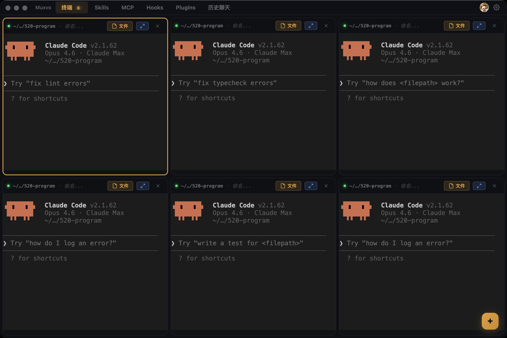
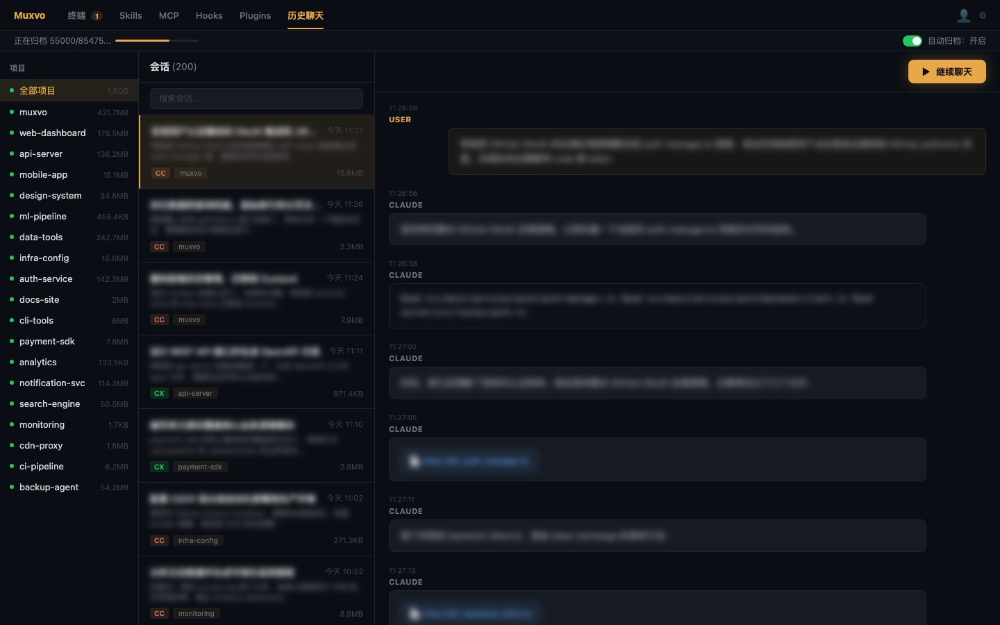
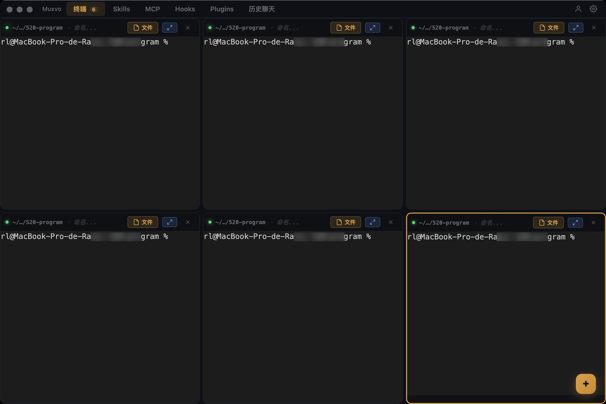
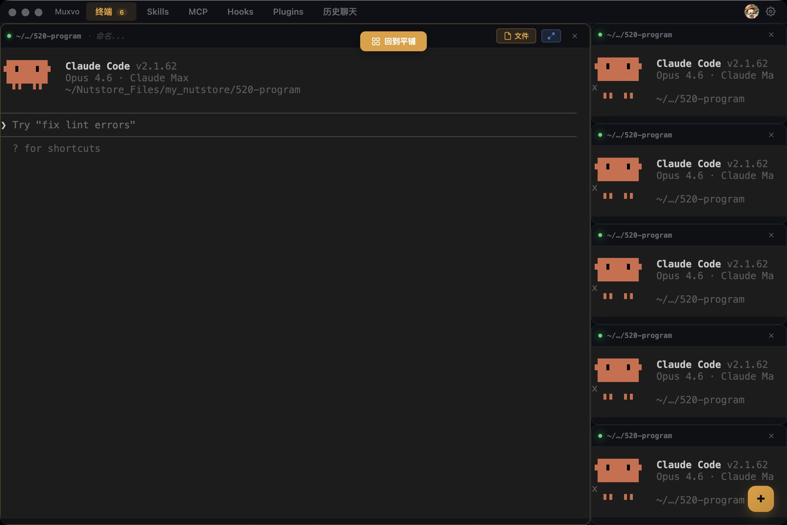
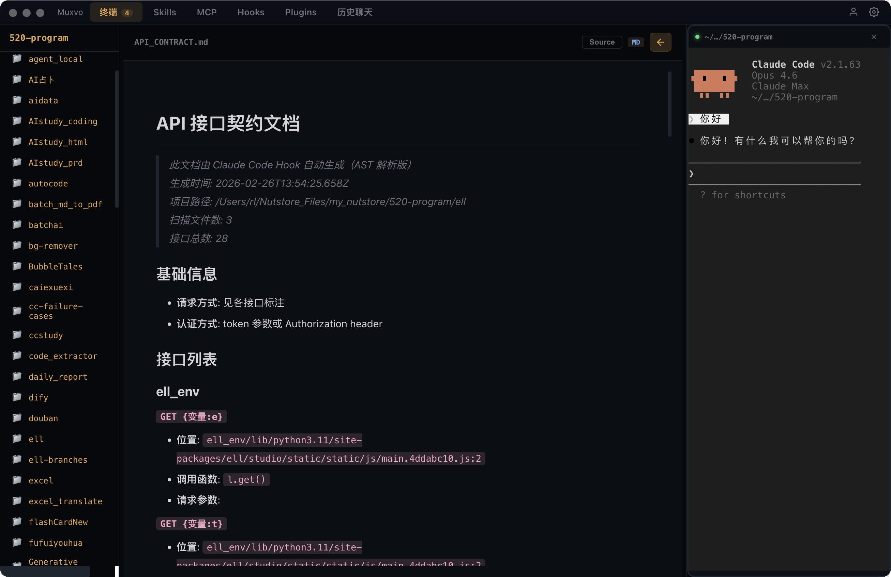
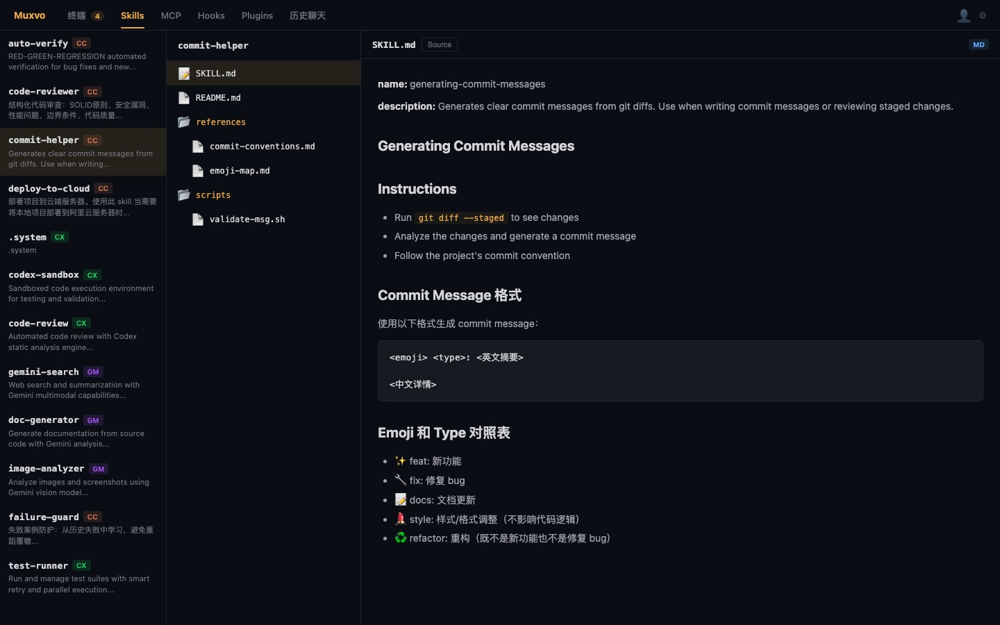
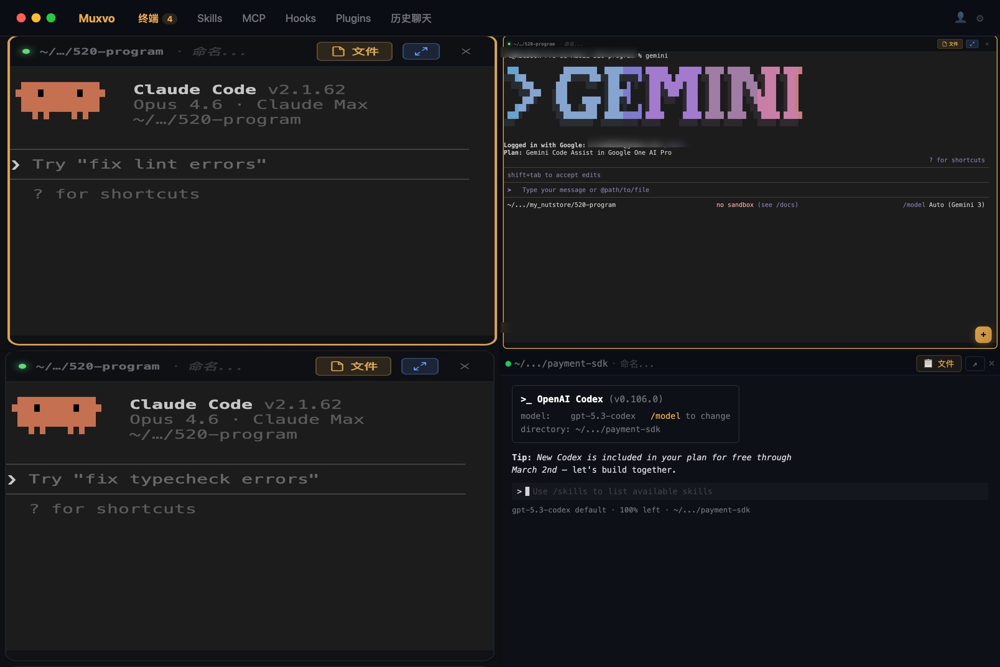

<div align="center">

# Muxvo

**Command your agent fleet.**

A native macOS workspace for Claude Code, Codex, and Gemini CLI —
Metal-rendered terminals in a tiled grid, with a permanent, searchable chat archive.

[](https://github.com/muxvo/muxvo/releases/latest)
[](https://muxvo.com)
[](LICENSE)

<p>
  <a href="https://muxvo.com"></a>
  &nbsp;&nbsp;
  <a href="https://muxvo.com"></a>
</p>

[Release notes](https://github.com/muxvo/muxvo/releases)



</div>

Running several AI coding agents at once turns your desktop into window
juggling: sessions buried under sessions, conversations that vanish after 30
days, config scattered across dotfiles. Muxvo is a native macOS app built for
exactly this workflow — a Swift + AppKit shell around a Metal-rendered terminal
core (built on [libghostty](https://github.com/ghostty-org/ghostty)), fast
where it counts and organized by design.

## Never lose a conversation



Claude Code auto-deletes conversations after 30 days. Muxvo archives every one
of them locally — browse and full-text search across all your projects, then
pick any conversation and resume it with one click.

## The whole fleet on one screen



Terminals tile into a grid, every session visible at a glance — that's a few
dozen ⌘Tabs a day you get back. Also on board: list mode (`⌘⇧L`), multiple
windows (`⌥⌘N`), and minimize-to-rail for sessions you want out of the way but
not gone.

## Focus without losing the room



One click maximizes the current terminal; the rest shrink into a sidebar for
instant switching. Big screen for the code, small tiles for the progress bars.

## Files, right where you work



A button beside the terminal slides out the project file tree. Open a file and
edit it in place — WYSIWYG Markdown, syntax-highlighted code — without ever
switching away.

## Skills & MCP at a glance



Muxvo auto-scans the Skills and MCP servers on your machine: what's installed
and where it lives, laid out in one panel instead of scattered directories.

## Not just Claude Code



Codex and Gemini CLI get the same treatment — conversations, skill
configuration, and chat history, all managed from the same interface.

## Install

**[Download the DMG from muxvo.com](https://muxvo.com)** — Apple Silicon
(M-series), macOS 14+. Muxvo keeps itself up to date with background updates.
You can also grab any build from
[GitHub Releases](https://github.com/muxvo/muxvo/releases/latest).

## Building from source

Everything goes through `scripts/app.sh` (the single build entrypoint):

```bash
scripts/app.sh build      # build the native app
scripts/app.sh run        # run it (needs `cd web && npm run dev` on port 5198)
scripts/app.sh test       # full Swift test suite
scripts/app.sh bundle     # assemble Muxvo.app (ad-hoc signed) into the build cache
scripts/app.sh install    # install to /Applications

# web panel
cd web && npm ci && npx vitest run
```

See `CLAUDE.md` for the full development guide, and `probes/VERSIONS.md` for the
pinned toolchain (ghostty / zig versions and how to build the vendored
libghostty artifacts).

## Architecture

- `app/` — the Swift package (SwiftPM). Terminal core, Metal renderer, session
  management, chat, file/settings, Sparkle auto-update.
- `web/` — the WKWebView panel UI (React + TypeScript).
- `bridge/` — the native ↔ web protocol (`protocol.core.json`) and its code
  generator (`codegen.mjs`). Both Swift and TypeScript types are generated.
- `specs/` — behavior specifications (`specs/behavior/`) driven by a spec runner;
  each spec has a 1:1 test.
- `tools/` — the spec runner and the visual-regression harness.
- `probes/` — standalone probes and benchmark hosts.

### Open core

This repository is the **open core** of Muxvo. The **orchestration engine** (the
AI task pipeline / task command center) is a separate proprietary component and
is not included here. The code in this repository builds and runs fully without
it — orchestration is wired into official builds through a thin seam
(`OrchLauncher` / `OrchGate`), which is a no-op stub in this repository. That is
the intended behavior; nothing here depends on the orchestration engine.

## License

GPL-3.0-or-later. See [`LICENSE`](LICENSE) and
[`THIRD-PARTY-NOTICES.md`](THIRD-PARTY-NOTICES.md). Contributions are accepted
under a CLA — see [`CONTRIBUTING.md`](CONTRIBUTING.md).
